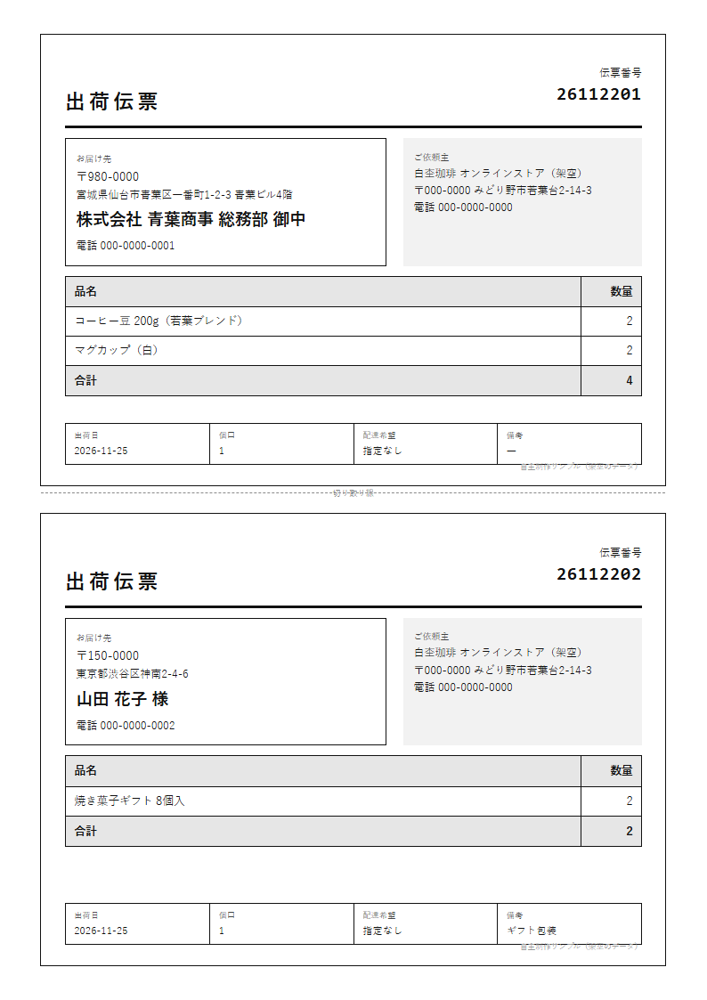
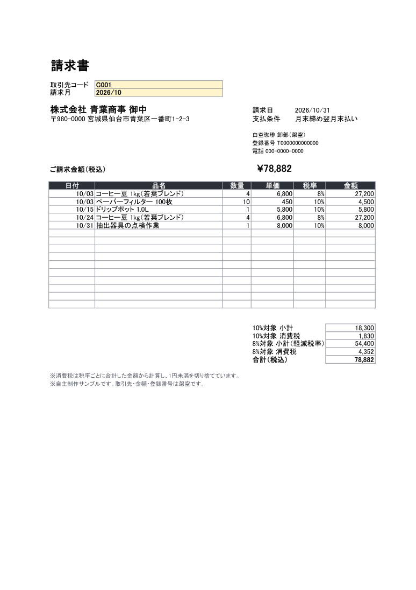

# データ変換・Excel自動化サンプル

> 自主制作サンプル：取引先・顧客・商品・金額はすべて架空のデータです。案件ごとに取り出せるよう、3つのフォルダに分けています。

## 1. CSV → PDF 変換（出荷伝票）　csv-to-pdf/

| ファイル | 内容 |
|---|---|
| input/orders.csv | 入力：受注データ（16行・伝票10件。同じ伝票番号の行は明細としてまとめます） |
| csv_to_pdf.py | 変換スクリプト（Python 3.10以上。追加ライブラリ不要、PDF化に Chrome または Edge を使用） |
| output/shipping_slips.pdf | 出力：A4 1枚に2伝票ずつ並べた出荷伝票（5ページ） |

- 宛先に法人格を含む場合は「御中」、個人は「様」を自動で付けます。CSVの「敬称」列で個別に指定もできます
- 必要な列が欠けている場合は、どの列がないかを表示して止まります

## 2. 請求書自動生成ブック　excel-invoice/

| ファイル | 内容 |
|---|---|
| invoice_book.xlsx | 請求書ブック（「請求書」「明細（入力）」「取引先」の3シート、マクロなし） |
| make_invoice_book.py | ブックを作り直すスクリプト（openpyxl） |
| output_invoice_C001_2026-10.pdf | 出力例：取引先C001・2026年10月分を PDF にしたもの |

- 「明細（入力）」に取引を入力し、「請求書」シートの黄色のセルで取引先コードと請求月を選ぶと、該当する明細・税率別の小計・消費税・合計が数式で表示されます
- 消費税は税率（10%・8%）ごとに合計してから計算し、1円未満を切り捨てています
- Excel で開いて、取引先・月を切り替えたときの計算結果を確認済みです（C001の10月分 78,882円、C002の10月分 37,128円。手計算と一致）

## 3. データ整形の Before／After　data-cleaning/

| ファイル | 内容 |
|---|---|
| before_customers.csv | Before：表記がばらばらな顧客リスト（15行） |
| clean_data.py | 整形スクリプト（openpyxl） |
| after_customers.xlsx | After：整形後（13行）・変更ログ（60件）・要確認（5件）の3シート |

| 項目 | Before の例 | After |
|---|---|---|
| 電話番号 | ０９０１２３４０００２ ／ (03)1234-0003 ／ 06 1234 0004 | 090-1234-0002 ／ 03-1234-0003 ／ 06-1234-0004 |
| 郵便番号 | 〒812-0000 ／ 1000000 | 812-0000 ／ 100-0000 |
| フリガナ | やまだ はなこ ／ ｻﾄｳ ｹﾝｲﾁ | ヤマダ　ハナコ ／ サトウ　ケンイチ |
| 登録日 | 令和8年3月1日 ／ R8.3.12 ／ 2026.6.18 | 2026-03-01 ／ 2026-03-12 ／ 2026-06-18 |
| 購入金額 | ¥12,000 ／ 8500円 ／ ２３０００ | 12000 ／ 8500 ／ 23000（数値） |
| 重複 | 電話番号が同じ2組 | 登録日が新しい行を残し、削除した行を変更ログに記録 |

直せない値（桁の足りない電話番号・存在しない日付・年のない日付・ローマ字のフリガナなど）は勝手に推測せず、「要確認」シートに理由と一緒に出します。

## 応募時の紹介文（3行）

CSVから出荷伝票のPDFを作る変換、請求書を数式で自動作成するExcelブック、表記ゆれを整えるデータ整形の自主制作サンプルです。
入力ファイル・スクリプト・出力ファイルをそろえ、変更ログと要確認の一覧で何を直したかを確認できるようにしています。
Excelのブックはマクロを使わず、取引先と月を選ぶだけで請求書が切り替わる作りです。
