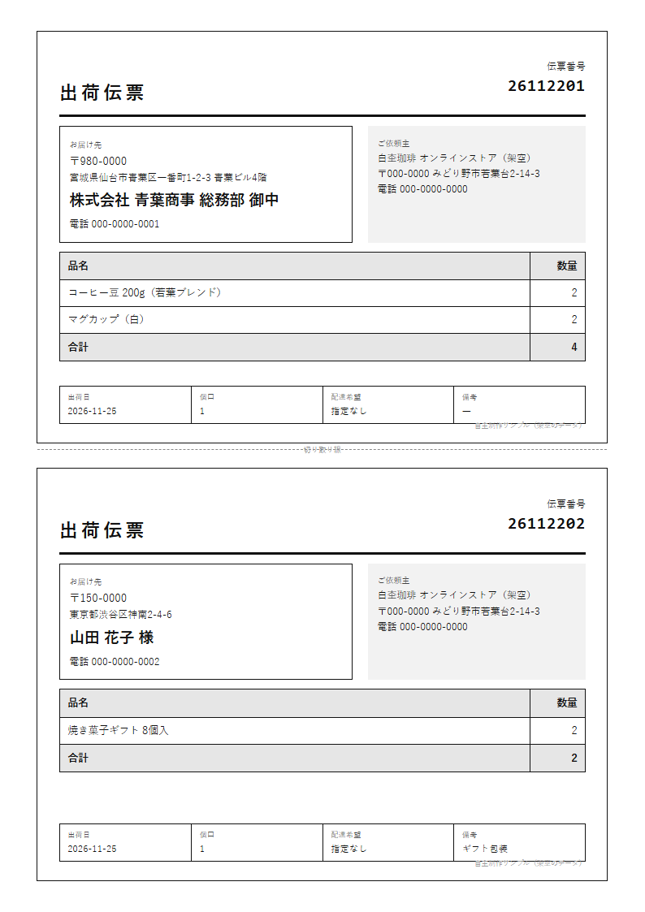

# CSV → PDF 変換（出荷伝票）

> 自主制作サンプル：取引先・顧客・商品・金額はすべて架空のデータです。

| ファイル | 内容 |
|---|---|
| input/orders.csv | 入力：受注データ（16行・伝票10件。同じ伝票番号の行は明細としてまとめます） |
| csv_to_pdf.py | 変換スクリプト（Python 3.10以上。追加ライブラリ不要、PDF化に Chrome または Edge を使用） |
| output/shipping_slips.pdf | 出力：A4 1枚に2伝票ずつ並べた出荷伝票（5ページ） |

- 宛先に法人格を含む場合は「御中」、個人は「様」を自動で付けます。CSVの「敬称」列で個別に指定もできます
- 必要な列が欠けている場合は、どの列がないかを表示して止まります

