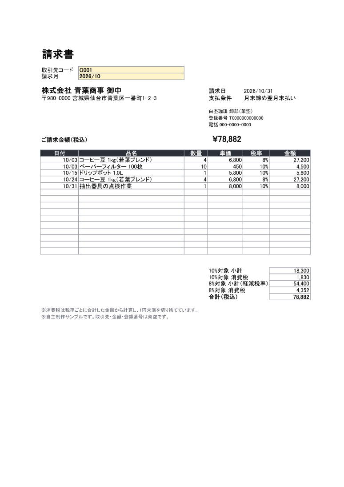

# 請求書自動生成ブック

> 自主制作サンプル：取引先・顧客・商品・金額はすべて架空のデータです。

| ファイル | 内容 |
|---|---|
| invoice_book.xlsx | 請求書ブック（「請求書」「明細（入力）」「取引先」の3シート、マクロなし） |
| make_invoice_book.py | ブックを作り直すスクリプト（openpyxl） |
| output_invoice_C001_2026-10.pdf | 出力例：取引先C001・2026年10月分を PDF にしたもの |

- 「明細（入力）」に取引を入力し、「請求書」シートの黄色のセルで取引先コードと請求月を選ぶと、該当する明細・税率別の小計・消費税・合計が数式で表示されます
- 消費税は税率（10%・8%）ごとに合計してから計算し、1円未満を切り捨てています
- Excel で開いて、取引先・月を切り替えたときの計算結果を確認済みです（C001の10月分 78,882円、C002の10月分 37,128円。手計算と一致）

