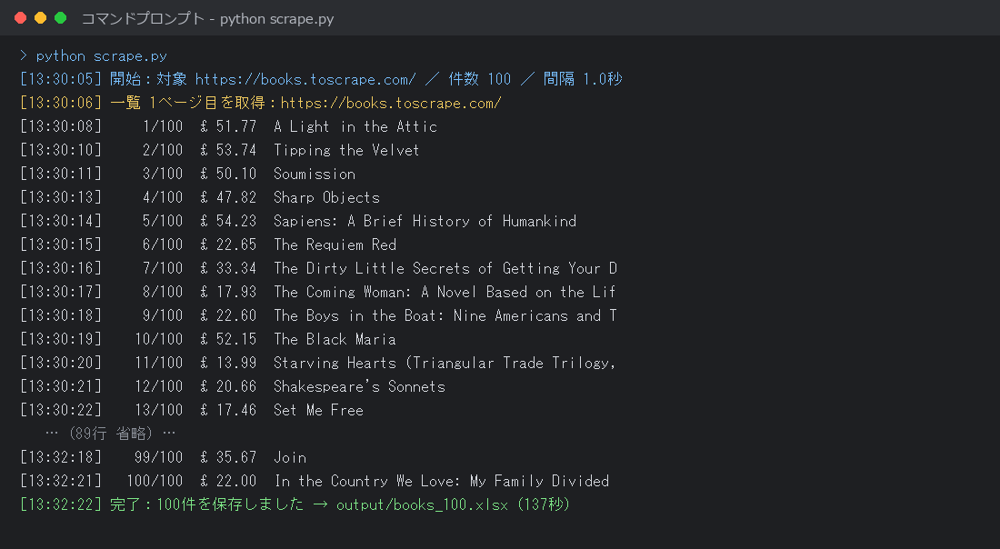
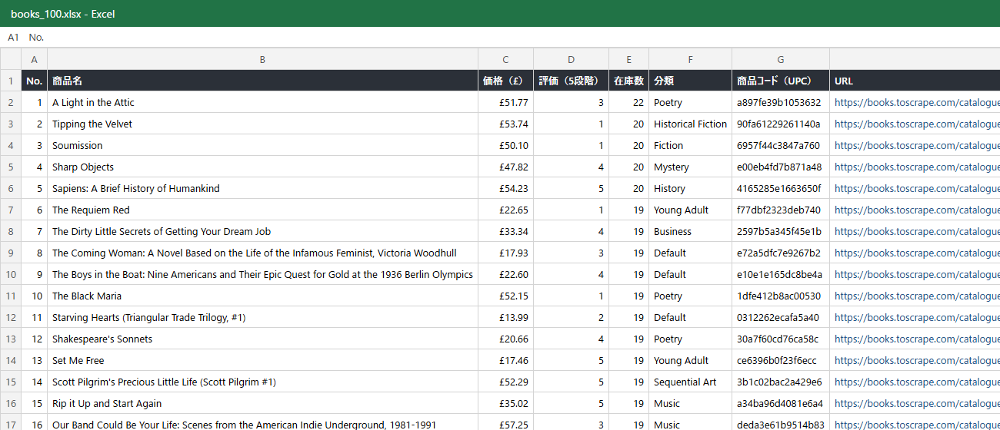

# 公開商品ページの収集デモ（スクレイピング実演セット）

> 自主制作サンプル：スクレイピング練習用に公開されているサンドボックスのECサイト（books.toscrape.com）を題材にしています。サイトの価格・評価はサイト側でランダムに付けられた値で、実在の商品情報ではありません。

## 成果物

| ファイル | 内容 |
|---|---|
| output/books_100.xlsx | 収集結果のExcel（商品名・価格・評価・在庫数・分類・商品コード・URL、100行）と取得条件のシート |
| scrape.py | 収集スクリプト（Python 3.10以上・openpyxl） |
| run-log.txt | 実行したときのログ（100件・137秒） |
| screenshots/run.png | 実行画面のキャプチャ |
| screenshots/excel.png | Excelの表示を再現したプレビュー画像（1〜18行目） |

## 処理の流れ

1. robots.txt を読み、取得が禁止されたページがないか確認します
2. 商品一覧のページを1ページ目から順に読み、商品名・価格・評価・詳細ページのURLを取り出します
3. 商品ごとに詳細ページを開き、分類・在庫数・商品コードを取り出します
4. 指定の件数（100件）に達したら止め、Excelに保存します
5. Excelには見出しの固定・絞り込み・価格の書式・URLのリンクを設定し、取得条件を別のシートに残します

## 実案件での条件の決め方

| 項目 | このデモ | 実案件で決めること |
|---|---|---|
| 対象 | books.toscrape.com の商品一覧・詳細ページ | 対象サイトのURL・取得してよいページの範囲 |
| 取得する項目 | 商品名・価格・評価・在庫数・分類・商品コード・URL | 必要な項目・表の列の順番 |
| 頻度 | 1回 | 1回のみ／毎週月曜の朝など。定期実行は Windows のタスクスケジューラで設定できます |
| 件数・時間 | 100件・約2分20秒 | 件数から所要時間を見積もります（1件あたり約1.4秒） |
| 納品形式 | Excel（.xlsx） | Excel・CSV・Googleスプレッドシート |

## 注意点

- 対象サイトの利用規約・robots.txt を確認し、収集が禁止されているサイトでは行いません
- ログインが必要なページ・会員限定の情報・認証を回避する処理は扱いません
- 1リクエストごとに1秒の間隔をあけ、サーバーに負荷をかけないようにしています（0.5秒未満は設定できない作り）
- 個人情報（氏名・メールアドレス・電話番号など）は収集しません
- サイトの作りが変わると取り出せなくなるため、定期実行する場合は取得件数を毎回ログで確認します

## 応募時の紹介文（3行）

ECサイトの公開商品ページから、商品名・価格・在庫数などを集めてExcelにまとめる収集スクリプトの自主制作サンプルです。
robots.txt の確認・1秒の取得間隔・失敗時の再試行を組み込み、ログインが必要な情報は扱わない範囲で作っています。
100件を約2分20秒で取得し、絞り込みとリンクを設定したExcelで納品します。
