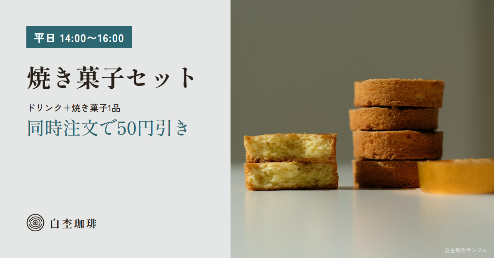
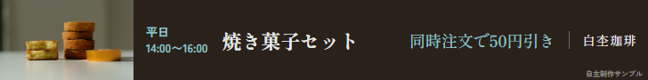

# バナー4サイズ・メニュー表：白杢珈琲

> 自主制作サンプル：架空のカフェ「白杢珈琲」の「平日14時〜16時の焼き菓子セット」（プレゼン資料サンプルの施策3）を告知するバナー・店頭のメニュー表です。写真は Unsplash License に基づき使用しています。

## ファイル

| ファイル | サイズ | 用途の例 |
|---|---|---|
| out/banner-1200x628.png | 1200×628px | Facebook・X の投稿、Webの記事内 |
| out/banner-1080x1080.png | 1080×1080px | Instagram の投稿・広告 |
| out/banner-728x90.png | 728×90px | Webサイトの横長の広告枠 |
| out/banner-300x250.png | 300×250px | Webサイトのレクタングル広告枠 |
| out/menu-a4.pdf ／ out/menu-a4.png | A4縦 | 店頭・テーブルに置くメニュー表（印刷用 PDF） |
| banners.html ／ menu.html | ― | 書き出し元のHTML。文字・価格を直して書き出し直せます |

## 作りの方針

- 4サイズとも、載せる情報を「時間帯・セット名・値引き・店名」の4つに絞り、小さいサイズほど文字の数を減らしています
- 配色・書体・ロゴは店のホームページ（P01）と同じです
- メニュー表は、ホームページと同じ価格・同じ言い切りの表記にしています

## 写真の出典

| ファイル | 配布元の画像URL |
|---|---|
| img/bake.jpg | https://images.unsplash.com/photo-1695016676286-32e1aee29825 |
| img/table.jpg | https://images.unsplash.com/photo-1552640895-d10bd57b2117 |

ライセンス：https://unsplash.com/license

## 応募時の紹介文（3行）

架空のカフェのキャンペーンを告知するバナー4サイズ・店頭用メニュー表の自主制作サンプルです。
サイズごとに載せる情報の数を変え、728×90のような細い枠でも時間帯・内容・値引きが読める配置にしています。
メニュー表は印刷用のA4のPDFで納品し、店のホームページと配色・価格の表記をそろえています。
