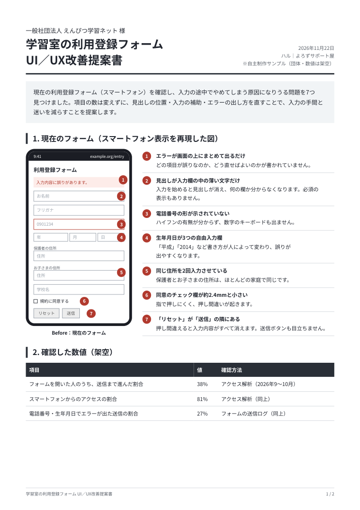
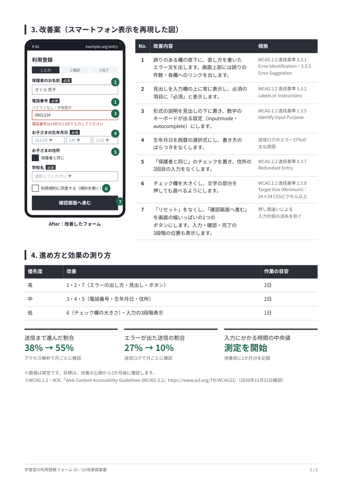

# UI／UX改善提案書サンプル：学習室の利用登録フォーム

> 自主制作サンプル：架空の団体「えんぴつ学習ネット」（Web制作サンプル P04 と同じ団体）の申込フォームを題材にした改善提案書です。団体・数値は架空です。

## ファイル

| ファイル | 内容 |
|---|---|
| uiux-proposal.pdf | 改善提案書（A4・2ページ） |
| index.html | 同じ提案書のHTML版（ブラウザで表示・印刷できます） |
| screenshots/page1.png・page2.png | 各ページの画像 |

## 内容

1. 現在のフォーム：スマートフォン表示を再現した図に、問題の箇所を番号で示す（7項目）
2. 確認した数値：送信まで進んだ割合・スマートフォンの割合・エラーの割合
3. 改善案：改善後の画面の図・7項目の改善内容・根拠（WCAG 2.2 の達成基準など）
4. 進め方と効果の測り方：優先度・作業の目安・目標の数値と確認方法

根拠に挙げた WCAG 2.2 の達成基準（1.3.5・2.5.8・3.3.1・3.3.2・3.3.3・3.3.7）は、W3C の公開ページ https://www.w3.org/TR/WCAG22/ で番号と名称を確認しています（2026年11月22日）。

## 応募時の紹介文（3行）

架空の申込フォームを題材にした、UI／UX改善提案書（A4・2ページ）の自主制作サンプルです。
現在の画面の図に問題の箇所を番号で示し、改善後の画面の図と改善内容・根拠を並べています。
根拠にはWCAG 2.2の達成基準を使い、優先度と効果の測り方まで書いています。
