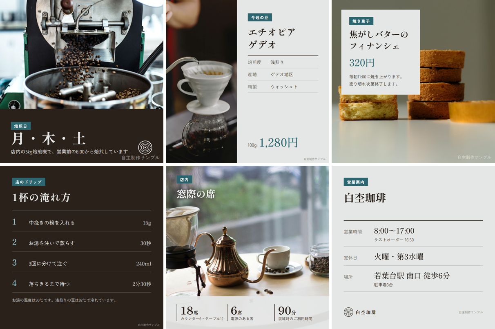

# Instagram投稿セット：白杢珈琲

> 自主制作サンプル：架空のカフェ「白杢珈琲」（Web制作サンプル P01 と同じ店）の投稿画像6枚・キャプション・1週間分の投稿カレンダーです。写真は Unsplash License に基づき使用しています。

## 投稿画像（1080×1080px・6枚）

| ファイル | 内容 | 作りの方針 |
|---|---|---|
| posts/post-01.png | 焙煎日（月・木・土） | 写真の下に、毎週変わらない情報を大きく置く |
| posts/post-02.png | 今週の豆 | 銘柄・焙煎度・産地・精製・価格を表にする |
| posts/post-03.png | 焼き菓子 | 写真を全面に使い、品名・価格・焼き上がり時刻だけを載せる |
| posts/post-04.png | 1杯の淹れ方 | 保存される投稿として、分量を4手順で示す |
| posts/post-05.png | 店内 | 席数・電源のある席・利用時間を数字で示す |
| posts/post-06.png | 営業案内 | 営業時間・定休日・アクセスを1枚にまとめる |

- 配色・書体は店のホームページ（P01）と同じにしています（ステンレス #E4E7E5・焦げ茶 #2B211B・焙煎機の緑 #2C6670、Shippori Mincho B1・Zen Kaku Gothic New）
- 画像は `posts/posts.html` から書き出しています。文字や価格を変える場合は HTML を直して書き出し直します

## キャプション

`captions.md` に6投稿分を載せています。1投稿の文は事実だけにし、ハッシュタグは5個までにしています。

## 1週間分の投稿カレンダー（2026年11月30日〜12月6日）

`calendar.xlsx`（「投稿カレンダー」「方針」の2シート）

| 日付 | 時刻 | 種類 | 投稿 |
|---|---|---|---|
| 11/30（月） | 7:30 | フィード | post-01 焙煎日 |
| 11/30（月） | 15:00 | ストーリーズ | 焙煎したての豆 |
| 12/1（火） | 12:00 | フィード（予約投稿） | post-02 今週の豆 |
| 12/2（水） | 10:30 | フィード | post-03 焼き菓子 |
| 12/2（水） | 11:05 | ストーリーズ | 焼き上がり（15秒の動画） |
| 12/3（木） | 19:00 | フィード | post-04 1杯の淹れ方 |
| 12/4（金） | 12:00 | フィード | post-05 店内 |
| 12/5（土） | 8:00 | フィード | post-06 営業案内 |
| 12/6（日） | 9:00 | ストーリーズ | 今週の投稿をハイライトに追加 |

## 応募時の紹介文（3行）

架空のカフェのInstagram投稿画像6枚・キャプション・1週間分の投稿カレンダーの自主制作サンプルです。
店のホームページと配色・書体をそろえ、価格・時刻・席数などの具体的な情報を1枚ずつ大きく載せています。
カレンダーには投稿の時刻・種類・素材を決めてあり、定休日は予約投稿で回す運用まで書いています。
